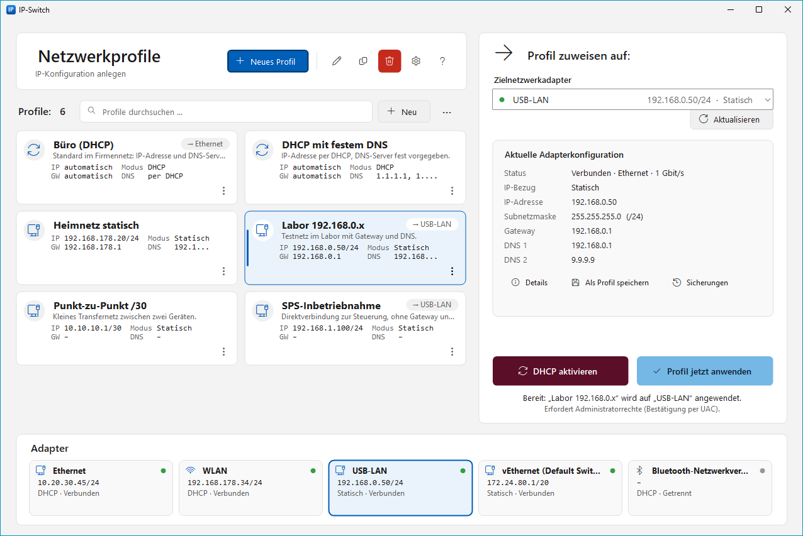
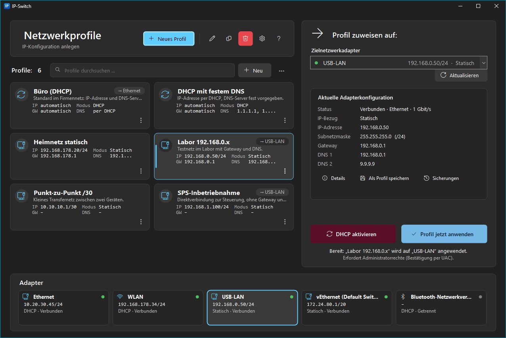
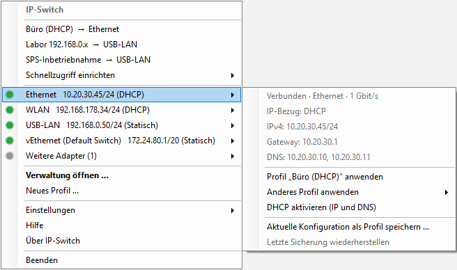

# IP-Switch

**Autor:** Mehmet Aslandag · **Lizenz:** [Apache 2.0](LICENSE) · [English](README.md)

IP-Switch ist eine schlanke Windows-Tray-Anwendung, mit der man IPv4-Konfigurationen von Netzwerkadaptern als
benannte Profile speichert und per Klick anwendet: statische Adresse, DHCP, Gateway und DNS.

- Läuft dauerhaft und ressourcenschonend im Infobereich (System-Tray). Es gibt kein Polling: Änderungen werden über
  Windows-Netzwerkereignisse erkannt, und das Verwaltungsfenster wird nur bei Bedarf erzeugt.
- Administratorrechte werden **nur** in dem Moment angefordert, in dem eine Netzwerkeinstellung geändert wird (UAC).
- Vor jeder Änderung wird die bisherige Konfiguration gesichert. Schlägt das Anwenden fehl, wird sie automatisch
  wiederhergestellt.
- Alle Daten liegen ausschließlich lokal. Es gibt keine Cloud-Anbindung, keine Telemetrie und keine Datenübertragung.

## Screenshots

| Heller Modus | Dunkler Modus |
|---|---|
|  |  |

**Tray-Menü** (Rechtsklick auf das Tray-Symbol):



<sub>Dargestellt mit Beispielprofilen und Beispieladaptern.</sub>

## Funktionen

| Bereich | Funktion |
|---|---|
| Adapter | Erkennt alle Netzwerkadapter mit IPv4. Zeigt Status, Typ, Geschwindigkeit, MAC, Kennung (GUID), aktive **und** gespeicherte IPv4-Konfiguration (Adresse/Präfix, Gateway, DNS, DHCP-Server). |
| Profile | Anlegen, Bearbeiten, Duplizieren, Löschen, Importieren, Exportieren (JSON). |
| Zuordnung | Profile können einem Adapter zugeordnet werden, im Profileditor oder direkt im Tray-Menü unter *Schnellzugriff einrichten*. Zugeordnete Profile erscheinen im Tray-Menü als Schnellzugriff. |
| Anwenden | Aus dem Tray-Menü (ein Klick) oder aus dem Verwaltungsfenster. Zusätzlich „DHCP aktivieren“ für IP und DNS. |
| Erfassen | „Aktuelle Konfiguration als Profil speichern“ übernimmt die Werte eines Adapters in ein neues Profil. Neue Daten lassen sich direkt erfassen und mit „Speichern und anwenden“ sofort setzen. |
| Sicherheit | Sicherung vor jeder Änderung, Überprüfung danach, automatischer Rollback bei Fehlern. „Letzte Sicherung wiederherstellen“ und eine Liste aller Sicherungen pro Adapter. |
| Validierung | Live-Prüfung im Editor mit verständlichen Meldungen, z. B. Gateway außerhalb des Subnetzes, Netz- oder Broadcast-Adresse, ungültige Maske, doppelte DNS-Server, doppelte Profilnamen. |
| Komfort | Autostart (optional), optional mit Administratorrechten (keine UAC-Abfragen), Einzelinstanz (ein zweiter Start öffnet das Fenster), Benachrichtigungen. |
| Sprachen | Oberfläche in Deutsch, Englisch, Türkisch, Französisch, Italienisch, Arabisch (von rechts nach links), Chinesisch (vereinfacht) und Russisch – folgt Windows oder wird im Tray unter *Einstellungen → Sprache* gewählt. Hilfe und Handbuch auf Deutsch und Englisch. |

### Inhalt eines Profils

| Feld | Pflicht | Hinweis |
|---|---|---|
| Name | ja | eindeutig, max. 64 Zeichen |
| Beschreibung | nein | max. 500 Zeichen |
| DHCP-Einstellung | ja | „automatisch beziehen“ oder „folgende IP-Adresse verwenden“ |
| IPv4-Adresse | bei statisch | z. B. `192.168.1.10` |
| Subnetzmaske oder Präfixlänge | bei statisch | `255.255.255.0`, `24` oder `/24` |
| Standardgateway | nein | muss im selben Subnetz liegen |
| Bevorzugter DNS-Server | nein | bei DHCP leer = DNS ebenfalls per DHCP |
| Alternativer DNS-Server | nein | nur zusammen mit bevorzugtem DNS-Server |
| Adapterzuordnung | nein | über die interne Adapterkennung |

## Bedienung

**Tray-Symbol:** Ein Klick mit der linken oder rechten Maustaste öffnet das Menü (siehe Screenshot oben).
- **Schnellzugriff** ganz oben: zugeordnete Profile als „Profil → Adapter“, ein Klick wendet an. Über
  *Schnellzugriff einrichten* ordnet man Profile direkt im Menü einem Adapter zu.
- **Ein Untermenü je Adapter** mit Status, IP, Gateway und DNS sowie „Profil … anwenden“, „Anderes Profil anwenden“,
  „DHCP aktivieren“, „Aktuelle Konfiguration als Profil speichern …“ und „Letzte Sicherung wiederherstellen“.
- **Einstellungen:** alle Adapter anzeigen, Erfolgsmeldungen, Mit Windows starten, Mit Administratorrechten starten,
  Jetzt mit Administratorrechten neu starten, Darstellung (Wie Windows / Hell / Dunkel), Sprache, Datenordner.

**Verwaltungsfenster:** Das Fenster ist im Kartenlayout aufgebaut. Es folgt dem Hell-/Dunkel-Modus von Windows;
umschalten lässt sich das im Tray unter *Einstellungen → Darstellung*.
- **Kopfbereich:** „Neues Profil“, Bearbeiten, Duplizieren, Löschen. Hinter dem Zahnrad liegen Import, Export und
  der Datenordner.
- **Profile:** Kacheln (ab ausreichender Fensterbreite zweispaltig) mit IP/Präfix, Gateway, Modus, DNS und
  zugeordnetem Adapter, darüber Suchfeld, „+ Neu“ und „⋯“. Das **⋮-Menü** jeder Kachel (auch per Rechtsklick)
  enthält: Auf den Zieladapter anwenden, *Zuweisen an ▸* (Adapter oder „Keine Zuordnung“), Bearbeiten,
  Duplizieren, Exportieren und Löschen.
- **Rechts, „Profil zuweisen auf:“:** Zieladapter wählen, „Aktualisieren“ und die aktuelle Adapterkonfiguration
  (mit Details, „Als Profil speichern“, Sicherungen). Darunter „DHCP aktivieren“ (Bordeaux) und „Profil jetzt
  anwenden“ (Himmelblau). Bei zugeordneten Profilen wird der passende Adapter automatisch gewählt.
- **Unten, „Adapter“:** alle Adapter als Kacheln mit Status, Adresse und Modus. Ein Klick wählt den Zieladapter;
  nicht mehr passende Adapter liegen hinter „+ N weitere“.

Tastenkürzel: `F5` aktualisieren, `Strg+N` neues Profil, `Strg+F` suchen, Pfeiltasten zum Wechseln zwischen
Kacheln, `Enter` oder Doppelklick bearbeiten, `Entf` löschen, Kontextmenütaste öffnet das ⋮-Menü.

## Sicherheit und Datenschutz

- **Rechtekonzept:** `IPSwitch.exe` läuft mit Standardrechten (`asInvoker`). Für eine Änderung startet sich die
  Anwendung selbst ein zweites Mal mit `runas` (UAC-Abfrage) als kurzlebigen Hilfsprozess. Dieser Prozess prüft
  den Auftrag erneut, sichert, wendet an, prüft das Ergebnis und beendet sich. Lehnt man die UAC-Abfrage ab, wird
  nichts geändert.
- **Optional ohne UAC-Abfragen:** *Einstellungen → Mit Administratorrechten starten* legt eine geplante Aufgabe
  „IP-Switch Autostart (Administrator) &lt;SID&gt;“ an. Sie startet IP-Switch bei der Anmeldung mit höchsten Rechten.
  Anlegen und Entfernen erfordern je eine UAC-Bestätigung. Läuft IP-Switch mit Administratorrechten, werden
  Änderungen direkt im Prozess ausgeführt, ohne Hilfsprozess und ohne Abfrage. Das Menü zeigt dann
  „IP-Switch (Administrator)“. Die Option ist nur für Administratorkonten verfügbar und bedeutet, dass die
  Anwendung dauerhaft mit erhöhten Rechten läuft.
- **Keine Shell, keine Injektion:** `netsh.exe` wird mit vollem Systempfad und einzeln übergebenen, vorher strikt
  validierten Argumenten gestartet.
- **Lokal:** Profile, Einstellungen, Sicherungen und das Protokoll liegen in `%LOCALAPPDATA%\IPSwitch`. Dieser Ordner
  wird bewusst nicht in servergespeicherte Profile synchronisiert. Die Anwendung öffnet keine Netzwerkverbindungen.

## Technische Umsetzung

| Aufgabe | Schnittstelle |
|---|---|
| Adapter und aktive Konfiguration lesen | `System.Net.NetworkInformation` (IP Helper API `GetAdaptersAddresses`) |
| Gespeicherte Konfiguration lesen, Überprüfung nach dem Anwenden | `HKLM\SYSTEM\CurrentControlSet\Services\Tcpip\Parameters\Interfaces\{GUID}` (nur lesend) |
| Konfiguration schreiben | `netsh interface ipv4 set/add/delete address|dnsservers name=<Index> …` |
| Änderungen erkennen | `NetworkChange.NetworkAddressChanged` / `NetworkAvailabilityChanged` |

**Adapterkennung:** Profile speichern die Interface-GUID des Adapters. Die GUID ändert sich nicht, wenn der Adapter
umbenannt wird. Als Rückfallebene dient die MAC-Adresse, z. B. wenn ein Adapter nach einer Treiber-Neuinstallation
eine neue GUID erhält. Name und Beschreibung werden nur zur Anzeige mitgespeichert. `netsh` wird über den
Interface-Index angesprochen, der unmittelbar vor der Änderung aus der GUID ermittelt wird. Dadurch spielen
Sonderzeichen oder Umbenennungen keine Rolle.

**Ablauf beim Anwenden:**

1. Zielkonfiguration validieren (in der Anwendung und erneut im Hilfsprozess).
2. Adapter über GUID bzw. MAC suchen und den aktuellen IPv4-Index ermitteln.
3. Aktuelle Konfiguration lesen und als JSON in `backups\` sichern. Ohne erfolgreiche Sicherung wird nichts geändert.
4. `netsh`-Befehle ausführen, zum Beispiel:
   ```
   netsh interface ipv4 set address name=12 source=static address=192.168.0.50 mask=255.255.255.0 gateway=192.168.0.1
   netsh interface ipv4 set dnsservers name=12 source=static address=192.168.0.1 validate=no
   netsh interface ipv4 add dnsservers name=12 address=9.9.9.9 index=2 validate=no
   ```
   Beim Wechsel zu DHCP werden die statischen Gateways und die bisherigen statischen Adressen ausdrücklich entfernt.
   `netsh … source=dhcp` lässt sie sonst aktiv stehen, und sie würden die Adresse für andere Adapter blockieren.
   Vor einer statischen Konfiguration prüft IP-Switch außerdem, ob die Adresse bereits auf einem anderen Adapter
   eingetragen ist. Windows lässt das nicht zu („Das Objekt ist bereits vorhanden“).
5. Ergebnis gegen die gespeicherte Konfiguration prüfen (mit kurzen Wiederholungen).
6. Bei einem Fehler in Schritt 4 oder 5 wird die Sicherung zurückgespielt und ebenfalls geprüft. Das Ergebnis
   erscheint mit allen ausgeführten Befehlen im Dialog „Details anzeigen“ und im Protokoll.

## Speicherorte

| Pfad | Inhalt |
|---|---|
| `%LOCALAPPDATA%\IPSwitch\profiles.json` | Profile |
| `%LOCALAPPDATA%\IPSwitch\settings.json` | Einstellungen |
| `%LOCALAPPDATA%\IPSwitch\backups\` | Sicherungen (max. 20 pro Adapter) |
| `%LOCALAPPDATA%\IPSwitch\logs\ip-switch.log` | Protokoll (max. 1 MB, eine Vorgängerdatei) |

Eine beschädigte `profiles.json` wird nicht überschrieben. Sie wird als `profiles.json.defekt-<Zeitstempel>`
gesichert, und es erscheint ein Hinweis.

## Profil-Dateiformat (Import/Export)

```json
{
  "format": "IPSwitch.Profiles",
  "version": 1,
  "profiles": [
    {
      "name": "Labor 192.168.0.x",
      "description": "Testnetz im Labor",
      "useDhcp": false,
      "ipAddress": "192.168.0.50",
      "subnetMask": "255.255.255.0",
      "gateway": "192.168.0.1",
      "preferredDns": "192.168.0.1",
      "alternateDns": "9.9.9.9",
      "adapter": { "interfaceId": "{42CA3769-…}", "macAddress": "02-1B-1B-AF-7E-00", "lastKnownName": "Ethernet" }
    }
  ]
}
```

Beim Import wird ein reines JSON-Array von Profilen ebenfalls akzeptiert. Ungültige Einträge werden mit Begründung
übersprungen, Namenskonflikte werden durch Umbenennen gelöst („Name (2)“). Beispielprofile liegen in
[`samples/beispielprofile.json`](samples/beispielprofile.json).

## Projektstruktur

```
IPSwitch.sln
├─ src/IPSwitch.Core/          Logik ohne UI: Modelle, Validierung, Speicherung, Adapter, netsh, Rollback,
│                              Übersetzungen (Localization/Strings/*.json)
├─ src/IPSwitch.App/           WinForms-Tray-Anwendung (Tray-Menü, Verwaltungsfenster, Editor, Hilfsprozess)
├─ tests/IPSwitch.Core.Tests/  xUnit-Tests (u. a. mit netsh-Simulator für Anwenden/Rollback)
├─ installer/                  WiX-Projekt für das MSI
├─ packaging/                  Installations-/Deinstallationsskripte für das ZIP-Paket
├─ samples/                    Beispielprofile
├─ tools/                      Erzeugung des Programmsymbols
├─ docs/                       Handbücher, Build- und Installationsanleitung, Screenshots
└─ build.ps1                   Tests, Veröffentlichung, ZIP- und MSI-Pakete
```

## Weitere Dokumentation

- [Benutzerhandbuch](docs/BENUTZERHANDBUCH.md) – ausführliche Bedienungsanleitung (auch in der App: **F1** bzw. Tray → **Hilfe**); englisch: [User Manual](docs/USER_MANUAL.md)
- [Build-Anleitung](docs/BUILD.md)
- [Installationsanleitung](docs/INSTALLATION.md)

## Grenzen

- Es wird nur IPv4 verwaltet. IPv6-Adressen werden angezeigt, aber nicht verändert.
- Ein Profil enthält genau eine Adresse und ein Gateway. Sicherungen stellen dagegen auch mehrere Adressen und Gateways
  wieder her.
- Die Gateway-Metrik bleibt auf „automatisch“. DNS-Suffixe, WINS und NetBIOS werden nicht verändert.
- Profile gelten pro Adapter, nicht pro WLAN-Netz (SSID).
- Gruppenrichtlinien oder Endpoint-Sicherheitsprodukte können Änderungen über `netsh` blockieren. Das wird als Fehler
  gemeldet, und die vorherige Konfiguration wird wiederhergestellt.
- Im Standardbetrieb erfordert jede Änderung eine eigene UAC-Bestätigung. Das ist bewusst so, damit keine dauerhaft
  erhöhten Prozesse laufen. Wer das nicht möchte, aktiviert *Mit Administratorrechten starten* (siehe oben).

---

IP-Switch wurde entwickelt von **Mehmet Aslandag**. Copyright © 2026 Mehmet Aslandag.
Lizenziert unter der [Apache License 2.0](LICENSE).
