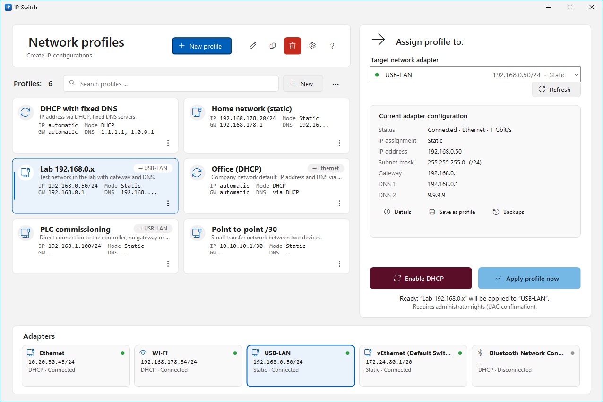
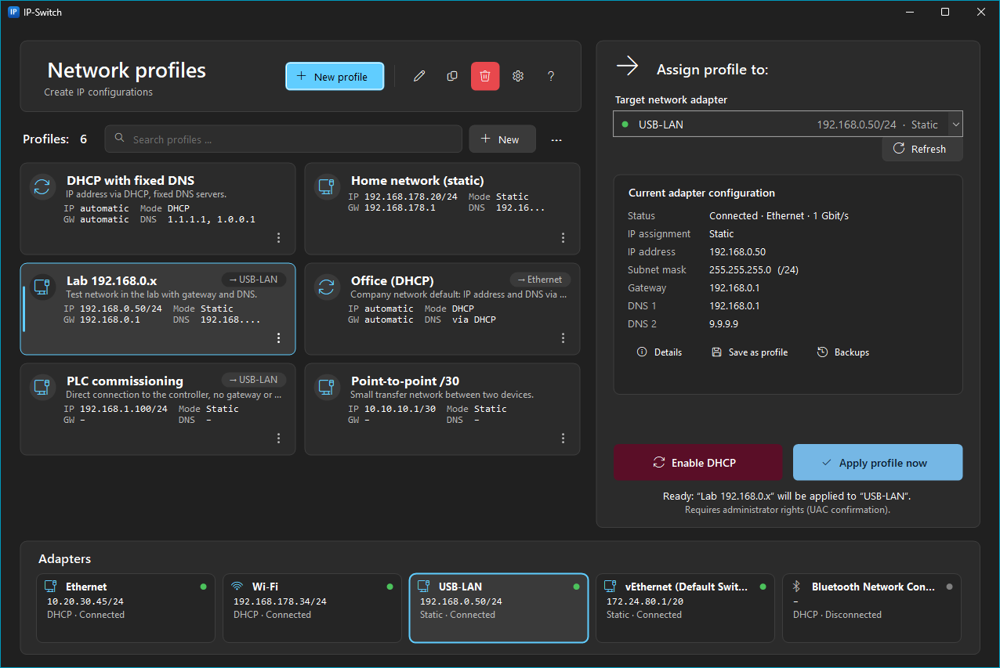
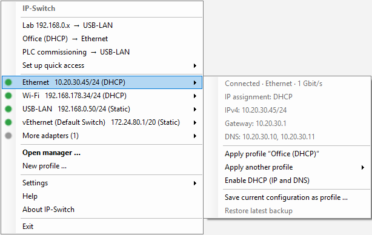

# IP-Switch

**Author:** Mehmet Aslandag · **License:** [Apache 2.0](LICENSE) · [Deutsch](README.de.md)

IP-Switch is a lightweight Windows tray application that stores IPv4 configurations of network adapters as named
profiles and applies them with one click: static address, DHCP, gateway and DNS.

- Runs permanently and resource-friendly in the notification area (system tray). There is no polling: changes are
  detected through Windows network events, and the manager window is only created when needed.
- Administrator rights are requested **only** at the moment a network setting is changed (UAC).
- Before every change the previous configuration is backed up. If applying fails, it is restored automatically.
- All data stays local. No cloud connection, no telemetry, no data transfer.
- User interface in 8 languages: English, German, Turkish, French, Italian, Arabic (right-to-left), Chinese
  (Simplified) and Russian.

## Screenshots

| Light mode | Dark mode |
|---|---|
|  |  |

**Tray menu** (right-click on the tray icon):



<sub>Shown with sample profiles and adapters.</sub>

## Features

| Area | Function |
|---|---|
| Adapters | Detects all network adapters with IPv4. Shows status, type, speed, MAC, identifier (GUID), active **and** saved IPv4 configuration (address/prefix, gateway, DNS, DHCP server). |
| Profiles | Create, edit, duplicate, delete, import, export (JSON). |
| Assignment | Profiles can be assigned to an adapter – in the profile editor, via the ⋮ menu of a profile tile or directly in the tray menu under *Set up quick access*. Assigned profiles appear in the tray menu as quick access. |
| Apply | From the tray menu (one click) or from the manager window. Plus “Enable DHCP” for IP and DNS. |
| Capture | “Save current configuration as profile” takes over the values of an adapter into a new profile. New values can be entered directly and set immediately with “Save and apply”. |
| Safety | Backup before every change, verification afterwards, automatic rollback on errors. “Restore latest backup” and a list of all backups per adapter. |
| Validation | Live checks in the editor with clear messages, e.g. gateway outside the subnet, network or broadcast address, invalid mask, duplicate DNS servers, duplicate profile names, address already used by another adapter. |
| Comfort | Autostart (optional), optionally with administrator rights (no UAC prompts), single instance (a second start opens the window), notifications, light/dark theme. |
| Languages | English, Deutsch, Türkçe, Français, Italiano, العربية (right-to-left), 中文 (Simplified), Русский – follows Windows or can be chosen in the tray under *Settings → Language*. Help and manual in English and German. |

### Profile content

| Field | Required | Notes |
|---|---|---|
| Name | yes | unique, max. 64 characters |
| Description | no | max. 500 characters |
| DHCP setting | yes | “obtain automatically” or “use the following IP address” |
| IPv4 address | if static | e.g. `192.168.1.10` |
| Subnet mask or prefix length | if static | `255.255.255.0`, `24` or `/24` |
| Default gateway | no | must be in the same subnet |
| Preferred DNS server | no | empty with DHCP = DNS via DHCP as well |
| Alternate DNS server | no | only together with a preferred DNS server |
| Adapter assignment | no | via the adapter's internal identifier |

## Usage

**Tray icon:** a left or right click opens the menu (see the screenshot above).
- **Quick access** at the top: assigned profiles as “Profile → Adapter”, one click applies. *Set up quick access* assigns
  profiles to adapters directly from the menu.
- **One submenu per adapter** with status, IP, gateway and DNS, plus “Apply profile …”, “Apply another profile”,
  “Enable DHCP”, “Save current configuration as profile …” and “Restore latest backup”.
- **Settings:** show all adapters, success notifications, start with Windows, start with administrator rights,
  restart with administrator rights now, appearance (same as Windows / light / dark), language, data folder.

**Manager window:** a card layout that follows the Windows light/dark mode (switchable in the tray under
*Settings → Appearance*).
- **Header:** “New profile”, Edit, Duplicate, Delete, ? (help). The gear holds import, export, data folder, help and
  about.
- **Profiles:** tiles (two columns when the window is wide enough) with IP/prefix, gateway, mode, DNS and the assigned
  adapter, plus a search box, “+ New” and “⋯”. The **⋮ menu** of each tile (also via right-click) contains: apply to
  the target adapter, *Assign to ▸* (adapter or “No assignment”), Edit, Duplicate, Export and Delete.
- **Right, “Assign profile to:”:** choose the target adapter, “Refresh” and the current adapter configuration (with
  details, “Save as profile”, backups). Below: “Enable DHCP” (bordeaux) and “Apply profile now” (sky blue). For
  assigned profiles the matching adapter is selected automatically.
- **Bottom, “Adapters”:** all adapters as tiles with status, address and mode. A click selects the target adapter;
  adapters that no longer fit are behind “+ N more”.

Shortcuts: `F1` help, `F5` refresh, `Ctrl+N` new profile, `Ctrl+F` search, arrow keys to move between tiles,
`Enter` or double-click to edit, `Del` to delete, menu key opens the ⋮ menu.

## Security and privacy

- **Rights model:** `IPSwitch.exe` runs with standard rights (`asInvoker`). For a change the application starts
  itself a second time with `runas` (UAC prompt) as a short-lived helper process. This process checks the request
  again, backs up, applies, verifies the result and exits. If the UAC prompt is declined, nothing is changed.
- **Optionally without UAC prompts:** *Settings → Start with administrator rights* creates a scheduled task
  “IP-Switch Autostart (Administrator) &lt;SID&gt;” that starts IP-Switch at sign-in with highest privileges. Creating and
  removing it each requires one UAC confirmation. When IP-Switch runs with administrator rights, changes are made
  directly in the process without a helper and without a prompt; the menu then shows “IP-Switch (Administrator)”.
  The option is available for administrator accounts only and means the application runs permanently elevated.
- **No shell, no injection:** `netsh.exe` is started with its full system path and individually passed, strictly
  validated arguments.
- **Local only:** profiles, settings, backups and the log are stored in `%LOCALAPPDATA%\IPSwitch`. This folder is
  deliberately not synchronised with roaming profiles. The application opens no network connections.

## Technical implementation

| Task | Interface |
|---|---|
| Read adapters and active configuration | `System.Net.NetworkInformation` (IP Helper API `GetAdaptersAddresses`) |
| Read saved configuration, verify after applying | `HKLM\SYSTEM\CurrentControlSet\Services\Tcpip\Parameters\Interfaces\{GUID}` (read-only) |
| Write configuration | `netsh interface ipv4 set/add/delete address|dnsservers name=<index> …` |
| Detect changes | `NetworkChange.NetworkAddressChanged` / `NetworkAvailabilityChanged` |
| Localisation | Embedded JSON files per language (`src/IPSwitch.Core/Localization/Strings/*.json`) with English fallback |

**Adapter identification:** profiles store the adapter's interface GUID, which does not change when the adapter is
renamed. The MAC address serves as fallback, e.g. when an adapter receives a new GUID after a driver reinstallation.
Name and description are stored for display only. `netsh` addresses the adapter by its interface index, which is
resolved from the GUID right before the change – special characters or renaming do not matter.

**Applying a configuration:**

1. Validate the target configuration (in the application and again in the helper process).
2. Find the adapter by GUID or MAC and determine the current IPv4 index.
3. Read the current configuration and save it as JSON in `backups\`. Without a successful backup nothing is changed.
4. Run `netsh` commands, for example:
   ```
   netsh interface ipv4 set address name=12 source=static address=192.168.0.50 mask=255.255.255.0 gateway=192.168.0.1
   netsh interface ipv4 set dnsservers name=12 source=static address=192.168.0.1 validate=no
   netsh interface ipv4 add dnsservers name=12 address=9.9.9.9 index=2 validate=no
   ```
   When switching to DHCP, static gateways and previous static addresses are removed explicitly – `netsh … source=dhcp`
   would otherwise leave them active, blocking the address for other adapters. Before a static configuration
   IP-Switch also checks whether the address is already assigned to another adapter, which Windows does not allow
   (“The object already exists”).
5. Verify the result against the saved configuration (with short retries).
6. On an error in step 4 or 5 the backup is restored and verified as well. The result appears with every executed
   command in the “Show details” dialog and in the log.

## Storage locations

| Path | Content |
|---|---|
| `%LOCALAPPDATA%\IPSwitch\profiles.json` | Profiles |
| `%LOCALAPPDATA%\IPSwitch\settings.json` | Settings (incl. theme and language) |
| `%LOCALAPPDATA%\IPSwitch\backups\` | Backups (max. 20 per adapter) |
| `%LOCALAPPDATA%\IPSwitch\logs\ip-switch.log` | Log (max. 1 MB, one previous file) |

A corrupt `profiles.json` is never overwritten. It is saved as `profiles.json.defekt-<timestamp>` and a notice is
shown.

## Profile file format (import/export)

```json
{
  "format": "IPSwitch.Profiles",
  "version": 1,
  "profiles": [
    {
      "name": "Lab 192.168.0.x",
      "description": "Test network in the lab",
      "useDhcp": false,
      "ipAddress": "192.168.0.50",
      "subnetMask": "255.255.255.0",
      "gateway": "192.168.0.1",
      "preferredDns": "192.168.0.1",
      "alternateDns": "9.9.9.9",
      "adapter": { "interfaceId": "{42CA3769-…}", "macAddress": "02-1B-1B-AF-7E-00", "lastKnownName": "Ethernet" }
    }
  ]
}
```

A plain JSON array of profiles is accepted as well. Invalid entries are skipped with a reason, name conflicts are
resolved by renaming (“Name (2)”). Sample profiles: [`samples/beispielprofile.json`](samples/beispielprofile.json).

## Build and installation

```powershell
.\build.ps1
```

produces in `artifacts\`: a self-contained ZIP (no .NET installation required), a small ZIP for the .NET 10 Desktop
Runtime and a per-user MSI (no administrator rights needed for installation). Details:

- [Build guide](docs/BUILD.md) (German)
- [Installation guide](docs/INSTALLATION.md) (German)
- [User manual](docs/USER_MANUAL.md) · [Benutzerhandbuch](docs/BENUTZERHANDBUCH.md)

Requirements: Windows 10 (1809+) or Windows 11 x64; for building, the .NET 10 SDK.

## Project structure

```
IPSwitch.sln
├─ src/IPSwitch.Core/          Logic without UI: models, validation, storage, adapters, netsh, rollback,
│                              translations (Localization/Strings/*.json)
├─ src/IPSwitch.App/           WinForms tray application (tray menu, manager window, editor, help, helper process)
├─ tests/IPSwitch.Core.Tests/  xUnit tests (incl. a netsh simulator for apply/rollback, translation checks)
├─ installer/                  WiX project for the MSI
├─ packaging/                  Install/uninstall scripts for the ZIP package
├─ samples/                    Sample profiles
├─ tools/                      Generation of the application icon
├─ docs/                       Manuals, build and installation guides, screenshots
└─ build.ps1                   Tests, publishing, ZIP and MSI packages
```

## Adding or improving a translation

All user interface texts live in `src/IPSwitch.Core/Localization/Strings/<code>.json`. The tests check that every
language contains exactly the keys of `en.json`, uses the same placeholders (`{0}`, `{1}`, …) and that every key used
in the source code exists. Missing texts fall back to English at runtime.

## Limitations

- Only IPv4 is managed. IPv6 addresses are shown but not changed.
- A profile contains exactly one address and one gateway. Backups, however, also restore multiple addresses and
  gateways.
- The gateway metric stays “automatic”. DNS suffixes, WINS and NetBIOS are not changed.
- Profiles apply per adapter, not per Wi-Fi network (SSID).
- Group policies or endpoint security products may block changes through `netsh`. This is reported as an error and
  the previous configuration is restored.
- In standard mode every change requires its own UAC confirmation. This is intentional so that no permanently elevated
  processes run. If you do not want this, enable *Start with administrator rights* (see above).

---

IP-Switch is developed by **Mehmet Aslandag**. Copyright © 2026 Mehmet Aslandag.
Licensed under the [Apache License 2.0](LICENSE).
